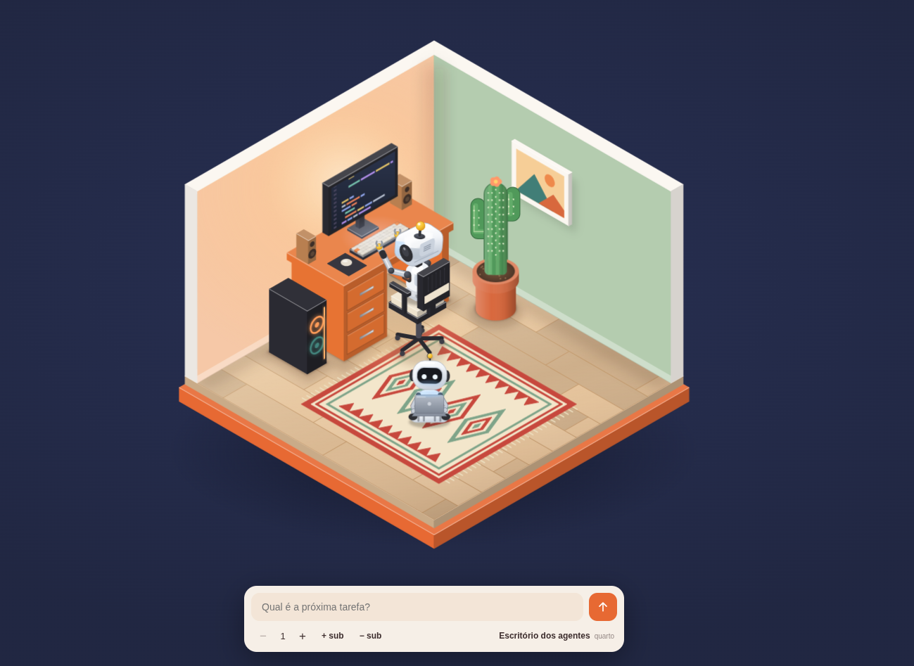

# Escritório isométrico dos agentes

Animação de um escritório em miniatura, no estilo *isometric room diorama*, onde cada quarto tem um **robô agente** trabalhando no computador e, no chão, **subagentes** com laptop no colo. Tudo é **SVG gerado por JavaScript puro**: sem imagens, sem bibliotecas 3D, sem build.



## Como rodar

Não precisa instalar nada. Abra o `index.html` no navegador, ou sirva a pasta:

```bash
python3 -m http.server 8000
# acesse http://localhost:8000
```

## O que dá para fazer

| Controle | Ação |
|---|---|
| `+` / `−` (ou teclas `+` e `-`) | Adiciona / remove um quarto com um agente (até 6) |
| `+ sub` / `− sub` (ou tecla `s`) | Adiciona / remove um subagente no quarto mais novo (até 4 por quarto) |
| Botões de estado | Trabalhando, Pensando, Esperando, Terminou, Finalizou, Ocioso (este só no agente principal: ele pega o celular) |
| **Pipeline** | Abre uma lista de etapas (ex.: planejamento, design, implementação). "Criar pipeline" gera um agente por etapa. As etapas ficam salvas no `localStorage` |
| `/` | Foca a barra de tarefa; `Esc` sai dela |

## Estrutura

```
index.html            página principal (barra superior, palco SVG, barra de controles, modal do pipeline)
css/estilo.css        estilos da interface e animações CSS (@keyframes)
js/iso.js             projeção isométrica P(x, y, z) e helpers de desenho (caixa, cilindro, formas planas...)
js/sala.js            desenha os quartos (piso, paredes, mesa, monitor, cacto, cadeira, luz e sombra)
js/robo.js            robô agente sentado à mesa, com estados e animação procedural
js/subagente.js       subagente menor, sentado no chão com laptop
js/tela.js            comportamento da tela: botões, contador e atalhos de teclado
js/pipeline.js        modal do pipeline (etapas salvas no localStorage)
personagem/           páginas isoladas para visualizar os personagens
doc/prompts.md        prompts usados para definir o estilo visual e as melhorias
```

## Como funciona

- **Projeção isométrica** (`js/iso.js`): `P(x, y, z) = [(x − y)·cos30°·U, (x + y)·0,5·U − z·U]`, com `U = 34`. O piso vai de 0 a 10 e as paredes têm altura 7.
- **Ordem de desenho** (*painter's algorithm*): o que está mais ao fundo é desenhado primeiro — base, piso, paredes, luz, quadro, tapete, sombras, mesa, monitor, gabinete, cacto, cadeira e robô.
- **Animação dos robôs**: cada estado define uma *pose-alvo*; a cada quadro a pose atual se aproxima dela com amortecimento, e por cima entra movimento procedural (senos) para digitar, acenar, pular e respirar. Há piscadas aleatórias, antena com mola, luz de estado, balões e confete.
- **Luz e sombra**: `radialGradient`, `feGaussianBlur` e `clipPath`.
- Respeita `prefers-reduced-motion`.

## Referência

- Vídeo de inspiração: https://www.youtube.com/watch?v=21ZjZJu3ZHo
